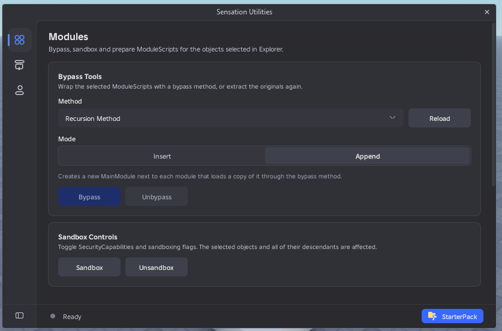
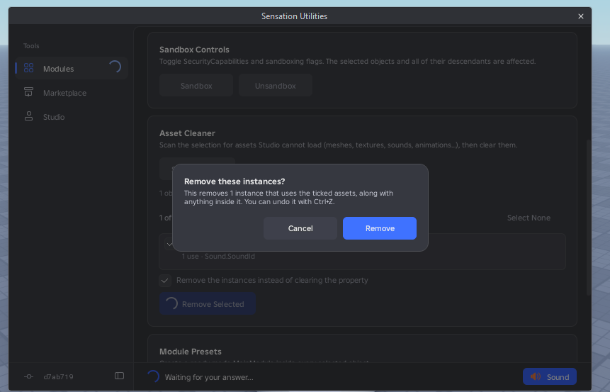

<div align="center">

# Sensation Utilities

**A dockable Roblox Studio toolkit for bypassing and sandboxing modules, cleaning broken assets, inserting and publishing assets, and spawning StarterCharacters.**

<p>
  <a href="https://github.com/Adi0nt/Sensation-Utilities-Plugin/releases/latest/download/Plugin.rbxmx"></a>
  <a href="https://create.roblox.com/store/asset/74082080143456"></a>
</p>

<p>
  
  
  
  <a href="LICENSE"></a>
</p>



<sub>The panel follows your Studio theme and collapses to an icon rail in a narrow dock.</sub>

<p>
  <a href="#what-it-does">What it does</a> ·
  <a href="#installation">Installation</a> ·
  <a href="#using-the-interface">Using it</a> ·
  <a href="#how-it-works">How it works</a> ·
  <a href="#development">Development</a> ·
  <a href="#troubleshooting">Troubleshooting</a>
</p>

</div>

---

## What it does

| | Page | What you can do |
| :---: | --- | --- |
|  | **Modules** | Bypass or unbypass ModuleScripts with a method you pick, sandbox a selection and everything under it, scan for assets Studio cannot load and clear them, and drop in a ready-made `MainModule` from your own `presets.rbxm`. |
|  | **Marketplace** | Insert an asset by ID (the latest version or a specific one), upload the selection to Roblox, or save it as an `.rbxm`. |
|  | **Studio** | Spawn an R6 or R15 StarterCharacter in `StarterPlayer` with one click. |

<details>
<summary><b>Details on each tool</b></summary>

<br>

| Tool | What it does |
| --- | --- |
| **Bypass Tools** | Methods are discovered dynamically from `methods.rbxm`. **Reload** fetches them again and keeps your selected method if it still exists. |
| **Sandbox Controls** | Toggles `SecurityCapabilities` and sandboxing flags on the selection *and all of its descendants*. |
| **Asset Cleaner** | **Scan Selection** checks every asset reference under the selection (meshes, textures, images, sounds, animations, skies, clothing, particles, ...) with Studio's `ContentProvider` and lists the ones that fail to load, with where each is used. Tick what to clean, then **Clean Selected** blanks those properties, or, with the "Remove the instances" checkbox, **Remove Selected** deletes the instances that hold them (always confirmed). It is one undo step. Nothing changes until you press Clean. **Clean Unloaded Sounds** is the older quick tool for sounds that report as not loaded. |
| **Module Presets** | Inserts the chosen preset as a `MainModule` into every selected object. The list comes from `presets.rbxm`; **Reload** fetches it again. |
| **Asset Insertion** | Inserts an asset into every selected object. Inputs are validated before anything is requested. |
| **Upload / Save** | Open Studio's native dialogs for the current selection. |

</details>

> [!NOTE]
> An asset *version* must be 1 or higher (choose **Latest** in the Version control instead of typing 0). If
> `StarterPlayer` already contains a `StarterCharacter`, you are asked before a second one is added. The cleaner scan
> can only tell whether *Studio* can load an asset, not whether other people can.

---

## Installation

### Local plugin (recommended, updates itself)

The local plugin fetches the latest updates every time Studio starts.

<p>
  <a href="https://github.com/Adi0nt/Sensation-Utilities-Plugin/releases/latest/download/Plugin.rbxmx"></a>
  <a href="https://raw.githubusercontent.com/Adi0nt/Sensation-Utilities-Plugin/main/loader.luau"></a>
</p>

1. **Open the Plugins folder.** In **Roblox Studio**, go to the **Plugins** tab on the top ribbon and click **Plugins Folder**.
2. **Add the plugin.** Move the downloaded `Plugin.rbxmx` (or `loader.luau`) into that folder.
3. **Restart Studio.** The **Sensation Utilities** button appears in your plugins toolbar.

<details>
<summary><b>Default Plugins folder locations</b></summary>

| OS | Path |
| --- | --- |
| **Windows** | `%LocalAppData%\Roblox\Plugins` |
| **macOS** | `~/Documents/Roblox/Plugins` |
| **Linux (Wine / Vinegar)** | `~/.var/app/io.github.vinegar_hq.Vinegar/data/vinegar/prefixes/studio/drive_c/users/$USER/AppData/Local/Roblox/Plugins` |

</details>

The loader downloads `plugin.luau` from this repository on every start, so updates need no reinstall.

### Creator Store

<p>
  <a href="https://create.roblox.com/store/asset/74082080143456"></a>
</p>

---

## Using the interface

| | |
| --- | --- |
| **Matches Studio** | Colours come from your Studio theme and follow it when you change themes. |
| **Dockable** | Open or close the panel with the **Sensation Utilities** toolbar button. It is a normal dock widget: dock, float, resize, hide and reopen it. Studio remembers where you left it. |
| **Floating window** | Prefer no docking? On the **Settings** page, switch Window to *Floating window*: the panel becomes a movable, resizable window over the 3D view (the old CoreGui setup), styled like a Studio panel. Drag its title bar to move it and its left edge, bottom edge or bottom-right corner to resize it; the toolbar button and its close button show and hide it. Your choice, the window's place and size, and whether it was open are saved, and you can switch back to the dock at any time. No dock widget is created while you use it. |
| **Navigation** | Modules, Marketplace, Studio and Settings live in a sidebar that collapses to an icon rail in a narrow dock. Items carry live markers: the selected ModuleScript count on Modules, and a spinner on whichever page is running an operation. |
| **Selection** | A chip at the right of the status bar shows what is selected in Explorer, with the same class icon Explorer uses. |
| **Status** | Every action reports its outcome in the status bar. Success and info messages fade back to *Ready*; warnings and errors stay until you dismiss them. Output-window logging is unchanged. |
| **Gated buttons** | Buttons are disabled until what they need exists (a selection, a ModuleScript, a valid asset ID, loaded methods). Hover a disabled button to see why. |
| **One at a time** | Only one action runs at a time, so a slow download cannot be submitted twice. |
| **Confirmations** | Operations that would touch many instances (more than 10 ModuleScripts or targets, or more than 250 instances including descendants) ask first, and so does removing instances from the Asset Cleaner. |
| **Undo** | Each scene change is wrapped in one `ChangeHistoryService` recording (best effort), so it should undo as a single step. Uploading and saving to a file leave Studio and cannot be undone from here. |

<div align="center">



<sub>Anything destructive asks first, and the status bar says it is waiting for you.</sub>

</div>

---

## How it works

```
Plugin.rbxmx / loader.luau   tiny loader, unchanged
        │  downloads on every Studio start
        ▼
plugin.luau                  plugin LIFECYCLE only: toolbar button, dock widget or floating window, downloads, mount / unmount
        │  downloads
        ├── packages.rbxm    Maid, RawLib (and some unused extras)
        ├── methods.rbxm     the bypass methods
        ├── presets.rbxm     the module presets (built from presets/)
        └── ui.rbxm          Flux + the application (built from src/ and vendor/, see below)
```

`ui.rbxm` is a [Rojo](https://rojo.space) build of:

| Path | Layer | Responsibility |
| --- | --- | --- |
| `src/Core` | **Utility operations** | The bypass, sandbox, cleaner, preset, asset and rig logic, and the floating window's placement rules (`Placement`: clamping, resizing, reading a saved position). No GUI or UI framework. Every operation returns a result `{ ok, level, message }`. Dependencies (plugin, selection, undo history, method and preset stores, raw property writes) are injected. |
| `src/UI/Theme.luau` | **Theme** | Every colour, font size, spacing, radius and motion value. Nothing else hardcodes them. Colours are read from the active **Studio theme** (`StudioStyleGuideColor`), so the panel matches Studio in any theme and rebuilds itself when you switch; surfaces, lines and hovers are derived from those colours. The structure follows Caelum's design system. |
| `src/UI/Components` | **Components** | Button, IconButton, Checkbox, TextInput / NumberInput, Dropdown, SegmentedControl, SectionHeader, Panel, Tooltip, StatusMessage, ConfirmationDialog, SelectionSummary, SidebarItem, ClassIcon, LoadingIndicator and the drawn icons. |
| `src/UI/State.luau` | **UI state** | One signal per value (page, selection, method, mode, inputs, status, busy, confirmation) plus computed values: derived selection summary, validation errors, and a *gate* per action that says why it is unavailable. |
| `src/UI/Actions.luau` | **Glue** | Runs an operation: refuses duplicates, shows progress, asks for confirmation, catches errors, reports the result. |
| `src/UI/Pages`, `src/UI/App.luau` | **Pages and shell** | Layout only. Pages: Modules, Marketplace, Studio and Settings. |
| `src/UI/FloatingWindow.luau` | **Floating window** | The CoreGui window used instead of the dock widget: a title bar, close button and resize handles around the area the app is mounted into. It only turns pointer input into `Placement` calls; `plugin.luau` decides which of the two hosts is used and keeps the choice in the plugin settings. |
| `vendor/flux` | **Dependency** | Flux **v0.5.2**, an unmodified copy of upstream `src/`, pinned and bundled (see [`vendor/flux/README.md`](vendor/flux/README.md)). MIT, license kept in `vendor/flux/LICENSE.md` and inside `ui.rbxm`. |

The whole UI is created inside one `Flux.mount` scope. Unloading the plugin destroys that scope, which tears down every
instance, connection, timer and reaction it owns.

---

## Development

<p>
  <a href="https://rojo.space"></a>
  <a href="https://lune-org.github.io/docs"></a>
  <a href="https://github.com/JohnnyMorganz/luau-lsp"></a>
</p>

> [!IMPORTANT]
> **Rebuild `ui.rbxm`** after changing anything in `src/` or `vendor/`, and commit it together with `plugin.luau`: the
> live plugin always downloads both from `main`.

```powershell
rojo build default.project.json -o ui.rbxm
```

**Presets live outside the code.** Each module preset is one script in `presets/` (`Advanced Module.luau`, `Basic Module.luau`). The file name is the preset's name, and an optional `Name.meta.json` can set a `Description` attribute for the line under the picker. Add, edit or remove files, then repack:

```powershell
rojo build presets.project.json -o presets.rbxm
```

You can also edit `presets.rbxm` directly in Studio (any script inside it is a preset; a string attribute `Description` is its description). The plugin downloads it on every Studio start, and **Reload** in the Module Presets panel picks up a change without restarting. The pure-logic tests fail if `presets.rbxm` is out of date with `presets/`.

<details>
<summary><b>Tests</b></summary>

<br>

**Pure-logic tests** (validation, formatting, method ordering, preset sources, asset references, floating-window placement):

```powershell
lune run tests/run
```

**Headless UI tests.** These mount the real `App`, the real `Core` operations and the real Flux on
[`sert`](https://github.com/kohltastrophe/sert), the headless Roblox-engine emulator Flux's own tests use. They click
buttons, hover, open dropdowns, check gating, confirmation, duplicate-submission protection, undo recording, status
fading and clean unmounting, switch between the dock and the floating window, drag and resize the floating window with simulated pointer input, then measure the layout at dock sizes from 320 px to 1400 px.

```powershell
lune run tests/smoke/prepare   # once, and after editing src/: mirrors the tree, downloads sert (SHA-256 verified)
lune run tests/smoke/app
lune run tests/smoke/layout
```

A short list of things a headless run cannot cover is in [`dev/MANUAL_TEST.md`](dev/MANUAL_TEST.md).

</details>

<details>
<summary><b>Type checking</b></summary>

<br>

This needs the new Luau type solver because Flux uses newer syntax:

```powershell
rojo sourcemap default.project.json -o sourcemap.json
luau-lsp analyze --flag:LuauSolverV2=true --definitions=globalTypes.d.luau --sourcemap=sourcemap.json --base-luaurc=.luaurc src plugin.luau
```

`globalTypes.d.luau` is the Roblox API definition file from the luau-lsp repository.

</details>

<details>
<summary><b>Updating Flux, or trying a branch</b></summary>

<br>

**Updating Flux:** replace `vendor/flux/src` with the new upstream `src/` and update `vendor/flux/README.md`, run the
tests, rebuild `ui.rbxm`.

**Trying a branch:** `plugin.luau` loads `packages.rbxm`, `methods.rbxm`, `presets.rbxm` and `ui.rbxm` from the `main` branch on GitHub.
To try a branch, temporarily change `RAW_MAIN` / `RAW_FRESH` at the top of `plugin.luau`, or use `dev/SensationDev.lua`
to point the loader at a local server.

</details>

---

## Troubleshooting

<details>
<summary><b>No plugin icon in the Plugins tab</b></summary>

Make sure the file is in the correct `Plugins` folder and restart all open Roblox Studio instances.

</details>

<details>
<summary><b>HTTP / GetAsync errors</b></summary>

Make sure your network allows connections to GitHub and that Studio has internet access enabled. The plugin needs
`HttpService` access to download its packages.

</details>

<details>
<summary><b>The panel opens but Bypass is disabled, or "No bypass methods are loaded"</b></summary>

The methods download failed. Check your connection and press **Reload** in *Bypass Tools*.

</details>

<details>
<summary><b>"No presets are loaded"</b></summary>

The presets download failed. Check your connection and press **Reload** in *Module Presets*.

</details>

<details>
<summary><b>Require / loading errors</b></summary>

Make sure you are using the official [Plugin.rbxmx](https://github.com/Adi0nt/Sensation-Utilities-Plugin/releases/latest/download/Plugin.rbxmx) loader.

</details>

---

## License and credits

Sensation Utilities is MIT licensed, see [`LICENSE`](LICENSE).

The interface is built with [Flux](https://github.com/kohltastrophe/flux) by Kohl, MIT licensed
([`vendor/flux/LICENSE.md`](vendor/flux/LICENSE.md)), and its design follows the Caelum design system. Headless tests use
[sert](https://github.com/kohltastrophe/sert), also by Kohl, downloaded on demand and not redistributed here.

<div align="center">

<sub>Made for Roblox developers · <a href="https://github.com/Adi0nt/Sensation-Utilities-Plugin/issues">Report an issue</a></sub>

</div>
